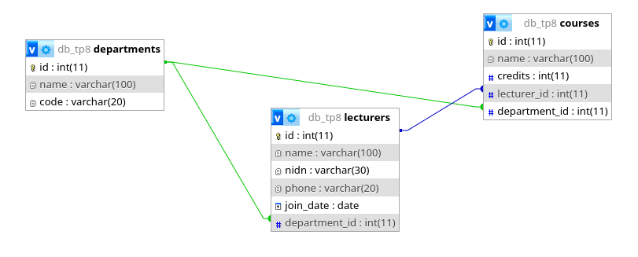

# TP 8 DPBO — MVC CRUD (Departments, Lecturers, Courses)

Tugas Praktikum 8 Mata Kuliah **Desain dan Pemrograman Berorientasi Objek (DPBO)**.

## Janji

Saya Nabila Attaya Putri Cahyadi dengan NIM 2508355 mengerjakan Tugas Praktikum 8 pada Mata Kuliah Desain dan Pemrograman Berorientasi Objek (DPBO) untuk keberkahan-Nya maka saya tidak melakukan kecurangan seperti yang telah dispesifikasikan. Aamiin

## Ringkasan Proyek

Aplikasi web PHP + MySQL untuk mengelola data akademik dengan arsitektur **MVC** (Model-View-Controller). Sebagai pemenuhan tugas, dua tabel baru ditambahkan dan dihubungkan dengan tabel yang sudah ada:

- **`departments`** — data departemen/jurusan.
- **`courses`** — data mata kuliah, terhubung ke `lecturers` dan `departments`.
- Atribut **`courses.department_id`** ditambahkan agar mata kuliah juga terhubung langsung ke departemen.

CRUD penuh (Create, Read, Update, Delete) tersedia untuk ketiga entitas: Departments, Lecturers, dan Courses.

## Struktur Folder

```text
TP8DPBO2526C1/
├── Project/
│   ├── index.php                     # front controller / router
│   ├── config/
│   │   └── database.php              # koneksi database (singleton)
│   ├── controllers/
│   │   ├── DepartmentController.php
│   │   ├── LecturerController.php
│   │   └── CourseController.php
│   ├── models/
│   │   ├── Department.php
│   │   ├── Lecturer.php
│   │   └── Course.php
│   ├── views/
│   │   ├── layouts/
│   │   │   ├── header.php
│   │   │   └── footer.php
│   │   ├── departments/
│   │   │   ├── index.php
│   │   │   ├── create.php
│   │   │   └── edit.php
│   │   ├── lecturers/
│   │   │   ├── index.php
│   │   │   ├── create.php
│   │   │   └── edit.php
│   │   └── courses/
│   │       ├── index.php
│   │       ├── create.php
│   │       └── edit.php
│   └── assets/                       # Bootstrap, jQuery, Popper
├── Dokumentasi/
│   ├── diagram.png
│   ├── departments_crud.mp4
│   ├── lecturers_crud.mp4
│   └── courses_crud.mp4
├── db_tp8.sql
└── README.md
```

## Diagram Desain



Relasi antar tabel:

- **Departments → Lecturers (1-N)**: satu departemen memiliki banyak dosen; `lecturers.department_id` → `departments.id`.
- **Lecturers → Courses (1-N)**: satu dosen dapat mengampu banyak mata kuliah; `courses.lecturer_id` → `lecturers.id`.
- **Departments → Courses (1-N)**: satu departemen memiliki banyak mata kuliah; `courses.department_id` → `departments.id`.

Ketiga foreign key memakai `ON DELETE SET NULL` dan `ON UPDATE CASCADE`, sehingga data anak tidak ikut terhapus saat data induk dihapus.

## Arsitektur MVC

- **Model** (`Project/models/`)
  - `Department.php` — query CRUD tabel `departments`.
  - `Lecturer.php` — query CRUD tabel `lecturers`; `all()` melakukan `LEFT JOIN` ke `departments` untuk menampilkan nama departemen.
  - `Course.php` — query CRUD tabel `courses`; `all()` melakukan `LEFT JOIN` ke `lecturers` dan `departments`.
  - Semua model memakai koneksi bersama dari `Database::getInstance()`.
- **View** (`Project/views/`)
  - `layouts/header.php` dan `layouts/footer.php` — kerangka HTML, navbar, dan pemuatan Bootstrap.
  - Setiap entitas punya tiga view terpisah: `index.php` (tabel data), `create.php` (form tambah), dan `edit.php` (form ubah).
  - Semua output data di-escape dengan `htmlspecialchars()`.
- **Controller** (`Project/controllers/`)
  - Menerima request, memanggil model, lalu memuat view.
  - `LecturerController` dan `CourseController` juga memuat model lain untuk mengisi dropdown relasi.
  - Setelah create/update/delete, controller melakukan redirect ke halaman index.
- **Front Controller** (`Project/index.php`)
  - Membaca `?c=` (controller) dan `?a=` (action), memvalidasi keduanya, lalu memanggil method controller yang diminta.

## Method Program

### Model dan Database (`Project/models/`, `Project/config/`)

| Class | Method | Fungsi |
|---|---|---|
| `Database` | `getInstance()` | Mengembalikan satu instance koneksi database (singleton). |
| `Database` | `getConnection()` | Mengembalikan objek koneksi `mysqli`. |
| `Department` | `all()` | Mengambil semua departemen, diurutkan dari ID terbesar. |
| `Department` | `find($id)` | Mengambil satu departemen berdasarkan ID. |
| `Department` | `create($data)` | Menambah departemen (`name`, `code`). |
| `Department` | `update($id, $data)` | Mengubah departemen berdasarkan ID. |
| `Department` | `delete($id)` | Menghapus departemen berdasarkan ID. |
| `Lecturer` | `all()` | Mengambil semua dosen beserta nama departemennya. |
| `Lecturer` | `find($id)` | Mengambil satu dosen berdasarkan ID. |
| `Lecturer` | `create($data)` | Menambah dosen (`name`, `nidn`, `phone`, `join_date`, `department_id`). |
| `Lecturer` | `update($id, $data)` | Mengubah dosen berdasarkan ID. |
| `Lecturer` | `delete($id)` | Menghapus dosen berdasarkan ID. |
| `Course` | `all()` | Mengambil semua mata kuliah beserta nama dosen dan departemen. |
| `Course` | `find($id)` | Mengambil satu mata kuliah berdasarkan ID. |
| `Course` | `create($data)` | Menambah mata kuliah (`name`, `credits`, `lecturer_id`, `department_id`). |
| `Course` | `update($id, $data)` | Mengubah mata kuliah berdasarkan ID. |
| `Course` | `delete($id)` | Menghapus mata kuliah berdasarkan ID. |

### Controller (`Project/controllers/`)

| Class | Method | Fungsi |
|---|---|---|
| `DepartmentController` | `index()` | Menampilkan tabel semua departemen. |
| `DepartmentController` | `create()` | Menampilkan form tambah; saat POST menyimpan data lalu redirect. |
| `DepartmentController` | `edit()` | Menampilkan form ubah; saat POST memperbarui data lalu redirect. |
| `DepartmentController` | `delete()` | Menghapus departemen berdasarkan `?id=` lalu redirect. |
| `LecturerController` | `index()` | Menampilkan tabel semua dosen. |
| `LecturerController` | `create()` | Menampilkan form tambah beserta pilihan departemen; menyimpan saat POST. |
| `LecturerController` | `edit()` | Menampilkan form ubah beserta pilihan departemen; memperbarui saat POST. |
| `LecturerController` | `delete()` | Menghapus dosen berdasarkan `?id=` lalu redirect. |
| `CourseController` | `index()` | Menampilkan tabel semua mata kuliah. |
| `CourseController` | `create()` | Menampilkan form tambah beserta pilihan dosen dan departemen; menyimpan saat POST. |
| `CourseController` | `edit()` | Menampilkan form ubah beserta pilihan dosen dan departemen; memperbarui saat POST. |
| `CourseController` | `delete()` | Menghapus mata kuliah berdasarkan `?id=` lalu redirect. |

## Alur Program

1. Pengguna membuka `index.php` (default `c=lecturer&a=index`) atau memilih menu **Lecturers**, **Departments**, atau **Courses** pada navbar.
2. Front controller `index.php` membaca parameter `c` dan `a`, memeriksa apakah controller dan action tersedia, lalu memuat file controller dan memanggil action tersebut.
3. Action `index()` memanggil `all()` pada model dan memuat view index untuk menampilkan data dalam tabel.
4. Action `create()` menampilkan form kosong. Saat form dikirim dengan metode POST, controller menormalkan nilai relasi (opsi kosong menjadi `NULL`), memanggil `create()` pada model, lalu redirect ke halaman index.
5. Action `edit()` mengambil data lama dengan `find($id)` dan menampilkannya pada form. Saat POST, controller memanggil `update()` lalu redirect ke halaman index.
6. Action `delete()` memanggil `delete($id)` lalu redirect ke halaman index. Tombol Delete meminta konfirmasi `Delete?` terlebih dahulu.
7. Setiap view index memuat `layouts/header.php` di awal dan `layouts/footer.php` di akhir agar tampilan konsisten.

## Validasi dan Error Handling

| Bagian | Kondisi tidak valid | Penanganan |
|---|---|---|
| `Project/index.php` | Parameter `c` tidak ada di daftar controller | Program berhenti dengan pesan `Controller not found`. |
| `Project/index.php` | Method `a` tidak ada pada controller | Program berhenti dengan pesan `Action not found`. |
| `Project/config/database.php` | Koneksi MySQL gagal | Program berhenti dengan pesan `Connection failed: ...`. |
| Form create Department | `name` atau `code` kosong | Dicegah browser melalui atribut `required`. |
| Form create Lecturer | `name`, `nidn`, `phone`, atau `join_date` kosong | Dicegah browser melalui atribut `required`. |
| Form create Course | `name` atau `credits` kosong | Dicegah browser melalui atribut `required`. |
| Form Lecturer / Course | Dropdown relasi tidak dipilih | Nilai string kosong diubah menjadi `NULL` sebelum disimpan. |
| Form Course | `credits` bukan angka | Nilai dikonversi dengan `(int)` sebelum disimpan. |
| Semua halaman | Data dari database berisi karakter HTML | Data yang ditampilkan di-escape dengan `htmlspecialchars()`. |
| Semua query dengan input | Potensi SQL injection | Query memakai prepared statement (`prepare` + `bind_param`). |
| Tombol Delete | Klik hapus tanpa sengaja | Dialog konfirmasi `Delete?` sebelum request dikirim. |
| Hapus data induk | Masih ada data anak yang merujuk | Foreign key `ON DELETE SET NULL` membuat kolom relasi anak menjadi `NULL`. |

## Dokumentasi

Screen record hasil pengujian aplikasi:


https://github.com/user-attachments/assets/d3d7241d-f5ce-4045-bfc9-647e020730d2


https://github.com/user-attachments/assets/7e8029b2-bf3e-45b4-b927-0a9312b8ee53


https://github.com/user-attachments/assets/2aad4187-e2ca-41cb-acf2-639f5e5cba6c

